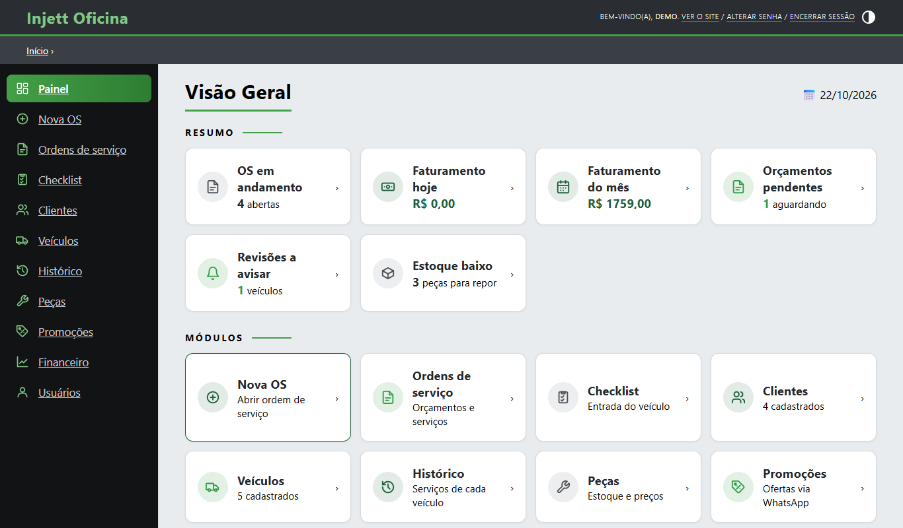
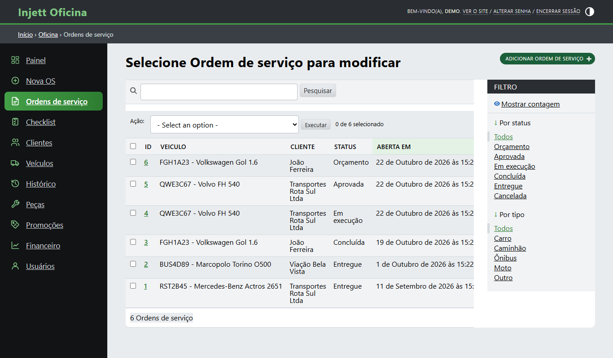
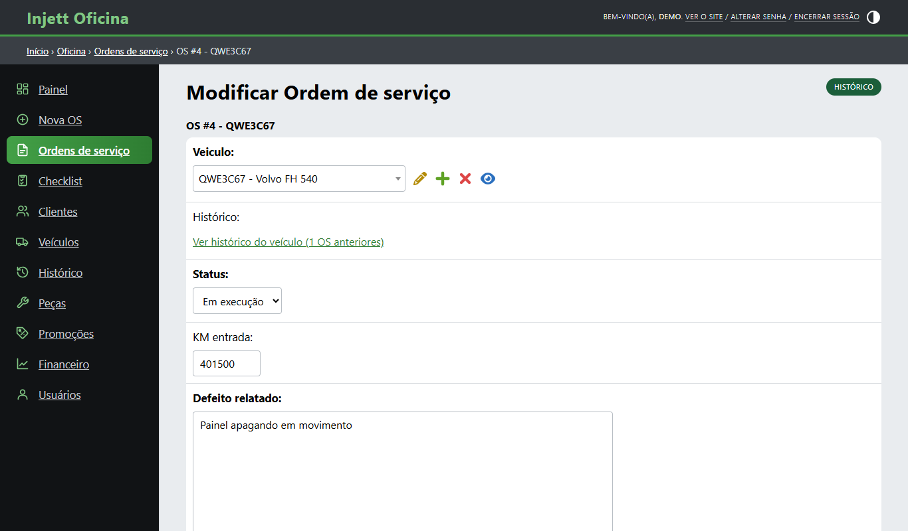
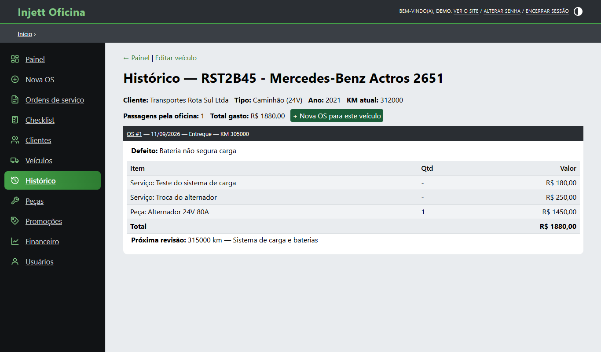
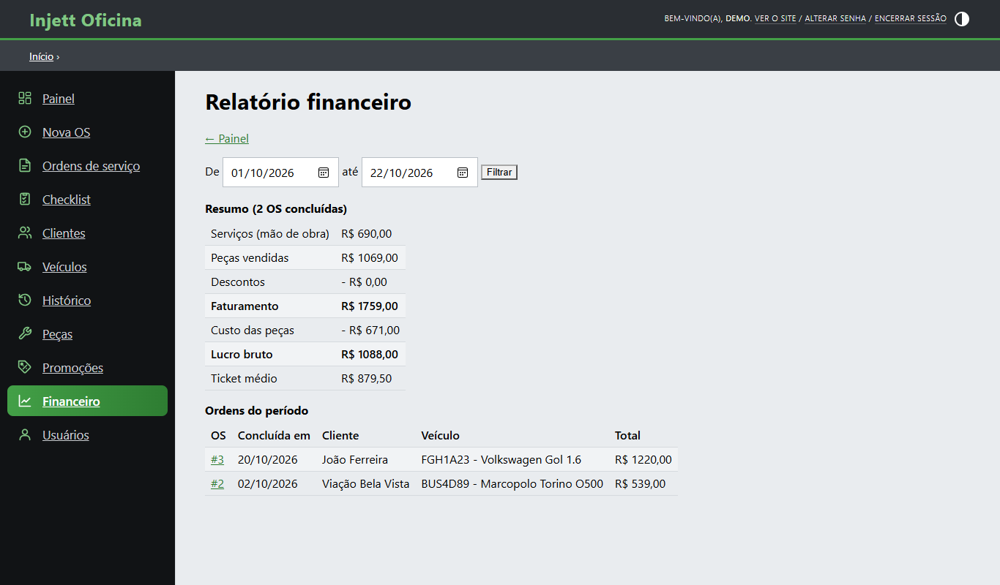
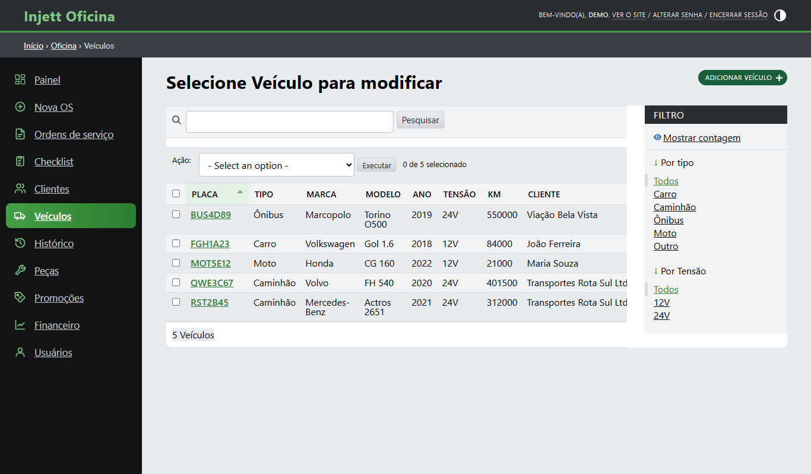
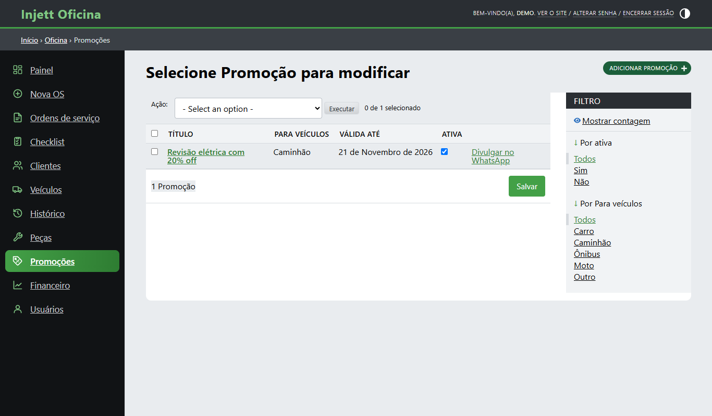
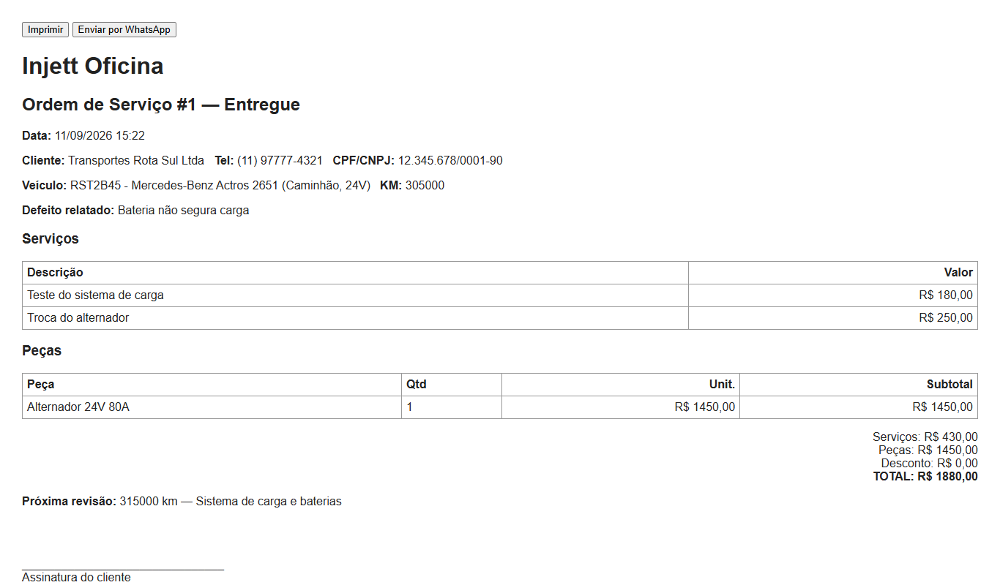

# Injett Oficina

Sistema de gestão para oficinas mecânicas e auto elétricas (carros, caminhões e ônibus), desenvolvido em **Python + Django**.

Projeto criado a partir da minha experiência prática como eletricista automotivo de veículos leves e pesados, unida à formação em Análise e Desenvolvimento de Sistemas.

## Funcionalidades

- **Painel em módulos**: OS em andamento, faturamento do dia e do mês, orçamentos pendentes, revisões a avisar e peças com estoque baixo
- **Cadastro de clientes e veículos**: tipo de veículo (carro, caminhão, ônibus, moto), placa, tensão do sistema elétrico (12V/24V) e quilometragem
- **Ordens de serviço** com fluxo de status: orçamento → aprovada → em execução → concluída → entregue
- **Serviços e peças por OS**, com cálculo automático do total e do desconto
- **Checklist de entrada do veículo** (combustível, itens elétricos, avarias e objetos), com impressão e link para o cliente
- **Controle de estoque**: a baixa é automática ao concluir a OS (sem baixa duplicada) e há um alerta de estoque mínimo
- **Impressão da OS** com campo para a assinatura do cliente
- **Envio do orçamento pelo WhatsApp** com um clique, com a mensagem formatada e os valores em R$
- **Relatório financeiro** por período: faturamento, custo das peças, lucro bruto e ticket médio
- **Histórico do veículo**: todas as passagens pela oficina, com KM, serviços, peças e total gasto. O KM do veículo é atualizado automaticamente pela OS
- **Lembrete de revisão** por KM e/ou data, com aviso ao cliente pelo WhatsApp em um clique
- **Promoções** filtradas por tipo de veículo, divulgadas aos clientes pelo WhatsApp

## Telas

**Painel**



**Ordens de serviço** (filtros por status e tipo de veículo)



**Edição da OS**



**Histórico do veículo**



**Relatório financeiro**



**Veículos** (filtros por tipo e por tensão 12V/24V)



**Promoções**



**OS para impressão**



## Tecnologias

- Python 3.13
- Django 6 (ORM, Admin customizado, templates)
- SQLite
- WhiteNoise e Gunicorn (produção)

## Como executar

```bash
python -m venv .venv
.venv\Scripts\activate          # Windows  (Linux/Mac: source .venv/bin/activate)
pip install -r requirements.txt
python manage.py migrate
python manage.py popular_demo   # opcional: usuário demo/demo12345 e dados de exemplo
python manage.py runserver
```

Acesse http://localhost:8000 e entre com o usuário `demo` (senha `demo12345`) ou crie o seu com `python manage.py createsuperuser`.

## Deploy

O arquivo `render.yaml` publica o sistema no [Render](https://render.com) (plano gratuito): no painel do Render, escolha **New → Blueprint** e selecione este repositório.

Variáveis de ambiente usadas em produção: `SECRET_KEY`, `DEBUG=False` e `ALLOWED_HOSTS`. No plano gratuito o SQLite é recriado a cada reinício, então a demonstração sempre volta aos dados de exemplo.

## Testes

```bash
python manage.py test
```

Os testes automatizados cobrem o cálculo do total, a baixa de estoque sem duplicidade, o alerta de estoque mínimo, as mensagens do WhatsApp, as revisões, o relatório financeiro e o controle de acesso.

## Estrutura

```
config/            configurações do projeto Django
oficina/
  models.py        Cliente, Veiculo, Peca, OrdemServico, ServicoOS, PecaOS, Checklist, Promocao
  admin.py         telas de cadastro, inlines e regras ao salvar a OS
  views.py         painel, histórico, impressões, promoções e relatório financeiro
  management/      comando popular_demo (dados de demonstração)
  tests.py         testes automatizados
  templates/       painel, admin personalizado e telas de impressão
render.yaml        deploy no Render
```

## Autor

**Evaristo Lourenço**: Análise e Desenvolvimento de Sistemas, com experiência em elétrica automotiva (leves e pesados).
